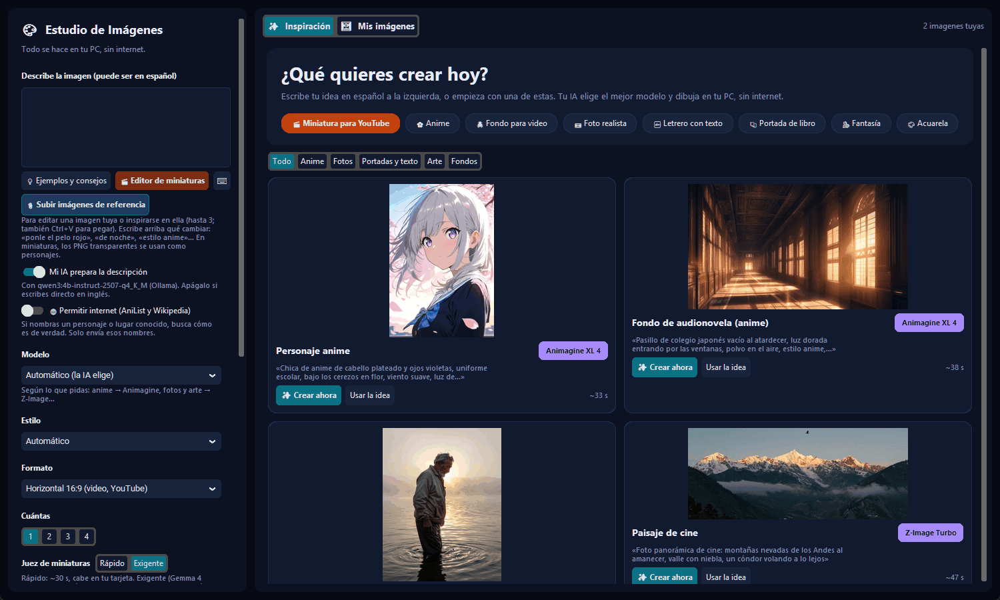
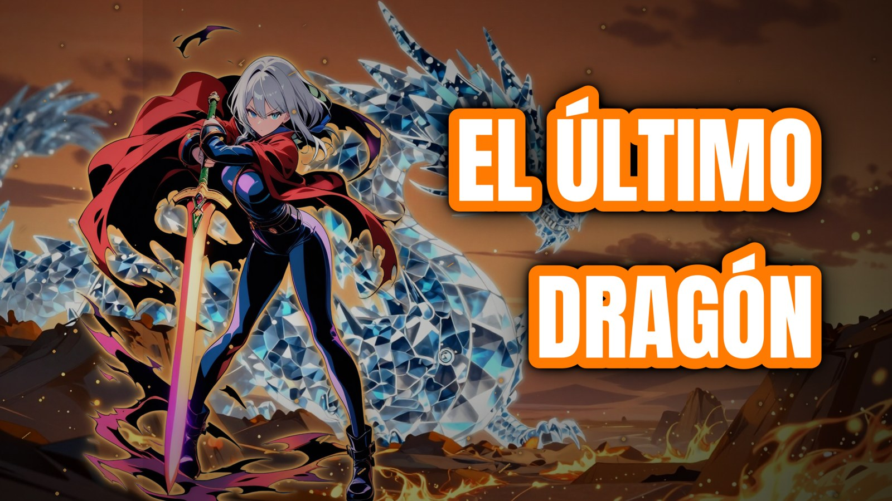
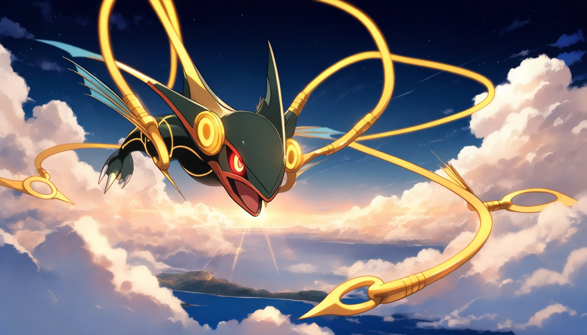
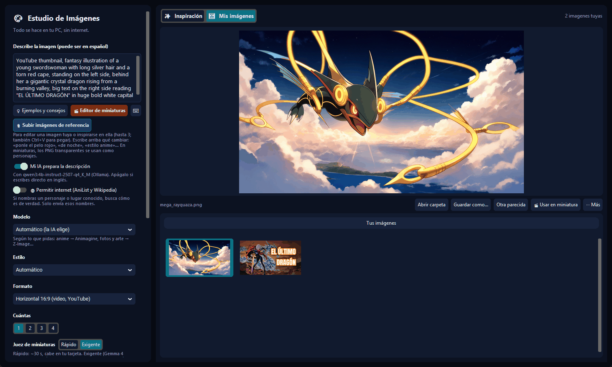
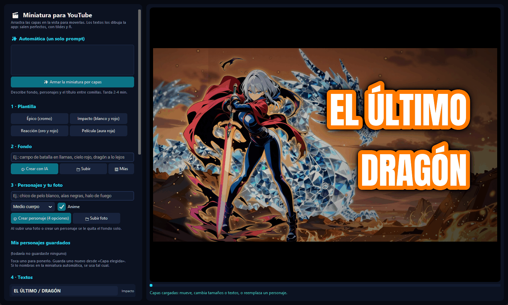

# Estudio de Imágenes

**Crea imágenes y miniaturas de YouTube con IA en tu PC con Windows: describes en español, tu tarjeta NVIDIA
dibuja, sin internet y sin pagar por imagen.**

### [⬇️ Descargar el instalador (Windows)](https://github.com/jyuniorjp/EstudioImagenes/releases/latest)

## Qué hace
- **Elige el modelo solo:** tu IA local (Qwen, con Ollama) lee lo que pides y escoge: anime y personajes
  conocidos (Pokémon, Genshin…) → Animagine XL 4; fotos, arte y texto → Z-Image Turbo; FLUX.2 Klein opcional (escenas con mucho detalle).
  También puedes elegirlo tú.
- **Revisa su trabajo:** Gemma 4 (una IA que ve) comprueba que la imagen tenga lo pedido —el género de cada
  persona, los objetos, los colores— y la dibuja otra vez si falta algo.
- **Miniaturas de YouTube en un paso:** escribe «miniatura de YouTube…» con el fondo, los personajes y el título
  entre comillas. Se arma por capas: fondo, personajes recortados sin bordes (pantalla de color + BiRefNet) y el
  título con letras perfectas donde y como lo pidas. Hace versiones A/B/C y recomienda la mejor.
- **Editor de miniaturas** por capas: plantillas, personajes guardados, efectos y atajos (Ctrl+Z, flechas, Supr…).
- **Tus imágenes:** hasta 3 de referencia (o pega con Ctrl+V) para editarlas o inspirarse; ampliar 2x/4x,
  quitar fondo, guardar en PNG, JPG, WEBP, BMP o TIFF. 11 medidas (1:1, 16:9, 9:16, 21:9…) y personalizada.

| Miniatura hecha con un solo prompt | Personaje conocido (Mega Rayquaza shiny) |
|---|---|
|  |  |

## Cómo probarlo
1. Descarga `Instalar_EstudioImagenes_1.1.0.exe` desde
   [Releases](https://github.com/jyuniorjp/EstudioImagenes/releases/latest) y ábrelo (no pide administrador).
   Si Windows dice «Windows protegió tu PC», pulsa **Más información → Ejecutar de todas formas**.
2. La primera vez la app revisa tu tarjeta, te explica qué descarga (motor ComfyUI y modelos), cuánto pesa cada
   parte y para qué sirve, y lo instala con un botón. Si se corta internet, sigue donde quedó.
3. Toca un ejemplo de la portada o escribe tu idea y pulsa **Crear imagen** (Ctrl+Enter).

### Requisitos
Windows 10/11 de 64 bits, tarjeta **NVIDIA** de 4 GB o más (mejor 6 GB) con controlador 580+, 16 GB de RAM y
unos 20 GB libres. Tiempos en una RTX 3060 de 6 GB: anime ~30 s, Z-Image ~55 s, miniatura completa 4-7 min.

## Compilar desde el código
Doble clic en `COMPILAR_IMAGENES.bat`: crea el entorno de Python, compila `EstudioImagenes.exe` con
PyInstaller y arma el instalador con Inno Setup 6.7+.

Más detalles de uso en [LEEME_IMAGENES.txt](LEEME_IMAGENES.txt). Este Estudio también viene integrado en
[Audio Novela Studio](https://github.com/jyuniorjp/AudioNovelaStudio), donde dibuja los fondos de los videos.

## Licencia
MIT: puedes usar, copiar y modificar este código mientras mantengas el aviso de autor. Ver [LICENSE](LICENSE).
Las fuentes de `fuentes/` usan la licencia SIL OFL 1.1.
